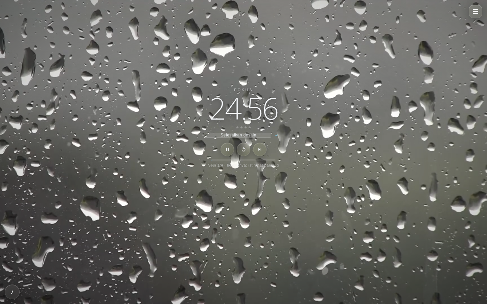

<p align="center">
  
</p>

<h1 align="center">Llora</h1>

<p align="center">
  <em>flora + aura — a calm, organic focus timer</em>
</p>

<p align="center">
  <a href="https://llora.llunaticsys.web.id"><strong>🌿 Live demo</strong></a>
</p>

---



Llora is a focus timer that feels like a quiet place, not a productivity tool. A true iOS-style **liquid glass** interface floats over cinematic video backgrounds while a boxless clock — in one of twelve typefaces — keeps the time. No build step, no frameworks, no dependencies: just open `index.html`.

## Features

**Timer**
- Drift-free engine (`Date.now()` deltas, 250 ms tick), custom focus / short / long durations (decimals allowed) via ± steppers, sessions-before-long-break, start / pause / reset / skip, progress bar, session dots, auto-continue.
- **Flow mode** — at 00:00 the timer never hard-stops: it chimes softly and counts *up* until you tap "Take a break →". Overtime banks into today's focus total.
- **Breathing transition** — a 15-second 4-7-8 breathing phase before breaks.
- Countdown in the tab title, optional browser notifications, Wake Lock keeps mobile screens alive.

**Ambience**
- Five cinematic 1080p video backgrounds (Rain on Glass, Rainforest, Night City, Cozy Room, Sea Sunset) with instant photo fallbacks, 800 ms crossfade, double-buffered switching.
- Paste any YouTube link as a fullscreen looping background; background-video sound toggle (off by default, so it never clashes with your music).

**Interface**
- Liquid glass with adaptive tint sampled live from the video frame.
- Boxless floating clock — drag it anywhere (position survives resize), twelve lazy-loaded typefaces, adjustable size, backdrop darkness + spread, and background dimmer so thin digits stay readable over any video. Press `C` to cycle styles.
- **Zen mode** — after 6 s without pointer movement, every chrome element fades away; only the clock and the video remain. Press `H` to toggle.
- **One Thing** — a single daily intention line under the clock; it dissolves when the session ends.
- Keyboard-first: `Space` play/pause, `M` mute, `N` next track, `1–5` backgrounds, `C` clock style, `T` timer/clock mode, `H` zen, `Esc` close panels.
- **Clock mode** — flip the top toggle (or press `T`) and Llora becomes a desk clock: live wall time in any of the twelve typefaces, blinking colon, date line. The timer keeps running underneath if you started one.

**Sound** (all synthesized in WebAudio — zero audio files, works offline)
- **Singing-bowl ritual** — a tactile thrum when focus begins, a Tibetan bowl strike at 00:00.
- **Soundscape mixer** — pink + brown + white noise through a slow-breathing lowpass filter, plus a 40 Hz binaural gamma beat. Four sliders in settings.

**Playlist**
- Titles-only panel — no YouTube chrome, ever. Hidden native audio and 1×1 YouTube players, auto-advance, graceful handling of embed-disabled videos.
- Paste a YouTube / YouTube Music playlist link to import every video as its own track — titles fill in automatically; Media Session API gives lock-screen controls.

**Sharing**
- **Share Vibe** — one click copies a link encoding your exact setup (background, clock style + position, soundscape, durations, current track). Recipients preview it in a session-only sandbox; "Keep it as mine" adopts it.

**PWA & persistence**
- Installable (`manifest.json`, `display: standalone`) with hand-made icons.
- One versioned `localStorage` key; daily focus seconds banked per day.

## Usage

```bash
# no build, no dependencies — just open it
open index.html

# or serve locally
python3 -m http.server 8000
```

## Customization

- **Background presets** — edit `BG_PRESETS` in `app.js` (clips live on the `assets` branch: `videos/*.mp4`, `posters/*`).
- **Glass look** — `--glass-*` and `--ambient` in `styles.css`.
- **Backdrop scrim** — Backdrop darkness / spread sliders in Settings → Clock style.
- **Storage** — key `pomodoro:v3`; "Erase all saved data" is in the settings panel.

## Tech

Vanilla HTML + CSS + JS. WebAudio (ritual + soundscape synthesis), Wake Lock, Notifications, Media Session, YouTube IFrame API (lazy), Pointer Events drag, `localStorage`. Verified with 100+ automated Playwright checks — real clicks across all twelve clock styles, drag persistence, playlist flows, soundscape, vibe-link round-trips, and screenshot review.

## License

MIT — see [LICENSE](LICENSE).
