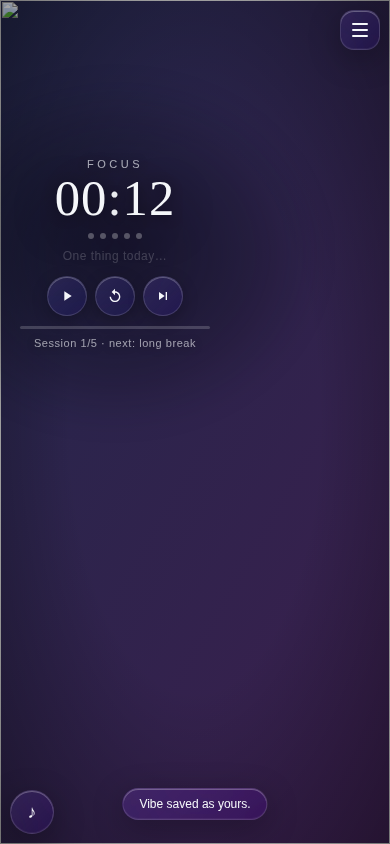

# Pomodoro

Pomodoro focus timer with a true iOS-style **liquid glass** UI: cinematic self-hosted 1080p video backgrounds, a boxless floating clock with 12 typefaces, titles-only playlist, Mode Hening, **Mode Mengalir** (overtime flow), singing-bowl ritual audio, and a procedural soundscape mixer. Static site — no build step, no frameworks, just open `index.html`.




## Features

- **Thin liquid glass** — `linear-gradient(135deg, rgba(255,255,255,.08), rgba(255,255,255,.02))`, `blur(12px) saturate(180%) contrast(105%)`, 1px `rgba(255,255,255,.14)` border, specular top-rim highlight. **Adaptive tint**: the dominant color of the current video frame is sampled every 2s (offscreen 16×16 canvas) and fed into `--ambient` for a subtle glow inside every glass surface. CORS-safe: `crossorigin` is set only for our jsDelivr URLs; custom URLs fall back to a neutral tint instead of throwing.
- **Video backgrounds, cinematic 1080p self-hosted** — five ~12s H.264 loops (Rain on Glass, Rainforest, Night City, Cozy Room, Sea Sunset) live on a dedicated `assets` branch and served via jsDelivr. Each preset has a **scenic photo fallback** (same branch, `posters/`) that shows instantly while the video loads — or if it fails. A **background video sound toggle** lets the ambient audio play (off by default so it never clashes with your playlist). Each is downscaled from a **4K source** and encoded `CRF 18 + tune grain + aq-mode 3` so rain and night scenes stay sharp instead of macroblocking. Double-buffered switching with 800ms crossfade; if a clip fails, a toast says so and the animated gradient fallback stays. **YouTube background engine**: paste any YouTube link as a custom background and it becomes a zoomed, muted, looping fullscreen iframe (chrome cropped away).
- **Pomodoro timer** — `Date.now()`-delta engine (no drift), 250ms tick, `Math.ceil` display, custom focus/short/long durations (decimals allowed, via ± steppers), sessions-before-long-break, start/pause/reset/skip, progress bar, session dots, auto-continue. **Flow mode**: at 00:00 the timer never hard-stops — it chimes softly, glows warm champagne, and counts *up* (+00:01…) until you tap "Take a break →"; overtime minutes are banked into today's focus total. **Breathing transition**: a 15s breathing phase (4-7-8 cadence, clock scales 1.0→1.06) before breaks. Tab title counts down; optional browser Notification. **Wake Lock** keeps mobile screens alive while running; video + sampler pause when the tab is hidden to save battery.
- **Boxless floating clock, 12 styles** — digits only, no card. Drag anywhere (Pointer Events + `setPointerCapture`, `touch-action: none`, 5px drag-vs-click disambiguation); position stored as viewport fractions so it survives resize. Twelve Google-Font typefaces (lazy-loaded, digit-subsetted ~2KB each): Air Thin, Classic Editorial, Japanese Cinema, Swiss Architect, Tall Capsule, Dusk Typewriter, Organic Glass, Art Gallery, Double Line, Nordic Minimal, Romantic Prose, and Vertical Zen (stacked layout). All with `tabular-nums` and dual-layer text shadow. The colon breathes while running. Press `C` to cycle.
- **Zen mode** — the signature moment: after 6s without pointer movement while the timer runs, every chrome element fades to invisible; only the floating clock and the video remain. Any movement wakes it; press `H` to force-toggle.
- **One Thing** — one 40-character intention line under the clock (per-day). It dissolves with a blur-out animation when the focus session ends or you tap ✓.
- **Singing-bowl ritual audio** — zero files: a tactile 90→45Hz thrum when focus begins, and a Tibetan singing-bowl strike at 00:00 (three inharmonic partials 1 : 2.756 : 5.404 with differential decay + 4Hz vibrato). Replaces the old beep alarm.
- **Soundscape mixer** — fully procedural WebAudio, zero files, works offline: pink noise (Paul Kellet filter) and brown noise routed through a slow-breathing lowpass (0.08Hz LFO, 700–1600Hz), plus a 40Hz binaural gamma beat (220Hz L / 260Hz R). All gain changes are click-free (`setTargetAtTime` ramping). Three mini sliders in settings; `M` mutes everything with a smooth fade.
- **Playlist, titles only** — a 44px ♪ FAB expands to a compact panel listing **only clean track titles** — no YouTube box, ever. Native `<audio>`/`<video>` engines stay hidden; YouTube plays through a 1×1px hidden IFrame player (auto-advance on end, graceful toast for embed-disabled videos). **Playlist import**: paste any YouTube or YouTube Music playlist link and the whole list loads natively into the hidden player — prev/next step between its videos. YouTube titles auto-fetched via noembed; Media Session API gives lock-screen controls for native audio.
- **Share Vibe** — one click copies a `#vibe=` link encoding your exact setup (background, clock style + position, soundscape levels, durations, current track). Opening it previews the vibe in a session-only sandbox — your own saved settings are never overwritten — with a "Keep it as mine" capsule to keep it. Only `https:` URLs are accepted from shared links.
- **Keyboard-first** — `Space` play/pause, `M` mute, `N` next track, `1–5` background preset, `C` next clock style, `H` Zen mode, `Esc` closes panels.
- **Settings (hamburger, top-right)** — background preset dropdown + custom URL (mp4/webm/YouTube) + background-sound toggle, clock-style dropdown, position reset, Share Vibe, duration steppers, Zen mode, breathing transition, soundscape sliders, sound/notification toggles, clear-all-data. All UI in English; the floating clock gets a soft dark scrim so thin digits stay readable over bright videos.
- **PWA-ready** — `manifest.json` (`display: standalone`) + hand-drawn SVG/PNG icons; install it to the home screen for fullscreen.
- **Persistence** — one versioned key, `pomodoro:v3` (migrates v1/v2 gracefully); daily focus seconds banked per-day.

## Usage

```bash
# just open it — no build, no dependencies
open index.html
# or serve locally
python3 -m http.server 8000
```

## Customization

- **Background presets** — edit `BG_PRESETS` in `app.js`. The bundled clips live on the `assets` branch (`videos/*.mp4`, ~15s 1080p H.264, no audio); serve your own via any CORS-enabled static host.
- **Glass look** — `--glass-*` and `--ambient` in `styles.css`.
- **Storage key** — `pomodoro:v3`; clear-all-data is in the settings panel.

## Tech

- Vanilla HTML + CSS + JS. Zero dependencies, zero build.
- Pointer Events drag, WebAudio (singing bowl + procedural noise + LFO filter), Wake Lock API, Notification API, Media Session API, YouTube IFrame API (lazy), `localStorage`.
- Tested with real click automation (Playwright + headless Chromium): timer accuracy, **Mode Mengalir** (overtime count-up → "Lanjut Rehat →" → breathing → break), breathing phase, drag + fraction persistence + click suppression, all **12 clock styles** (picker clicks, font lazy-load, zen layout), keyboard shortcuts (Space/M/N/1–5/C/H), playlist add/play/remove (titles-only), soundscape + mute, Mode Hening, YouTube background engine, **Bagikan Vibe** hash round-trip (session-only apply, keep persists, XSS guard), CORS-conditional video loading — plus screenshot review at 390×844 and 1440×900.

## Credits

Background clips (v3.5 set) — cinematic stock footage, free for commercial use (Pexels), downscaled from 4K and re-encoded `CRF 18 + tune grain`:

| Preset | Theme | Creator | Source |
|--------|-------|---------|--------|
| Hujan di Kaca | rain on glass, cold blue grade | Lenzatic | https://www.pexels.com/video/raindrops-on-window-in-blue-hues-33938710/ |
| Hutan Hujan | rain-soaked forest trail, misty | lauripoldre | https://www.pexels.com/video/a-serene-rain-soaked-hiking-trail-surrounded-by-green-foliage-stretching-into-the-distance-27700394/ |
| Kota Malam | wet city street at night, neon reflections | enkahramanmurat | https://www.pexels.com/video/vibrant-urban-night-scene-with-reflections-30284377/ |
| Ruang Hangat | steaming tea, books, rain-streaked window | Taryn Elliott | https://www.pexels.com/video/hot-tea-and-reading-glasses-while-raining-8549579/ |
| Senja di Laut | blue-hour ocean waves | Ferdous | https://www.pexels.com/video/tranquil-ocean-waves-at-twilight-34413592/ |

## Known limitations

- Headless test environments without video decode fall back to the gradient; playback is verified via `curl` + local-file code paths.
- YouTube embeds need the IFrame API (loaded lazily on first YouTube track).

## License

MIT — see [LICENSE](LICENSE).
